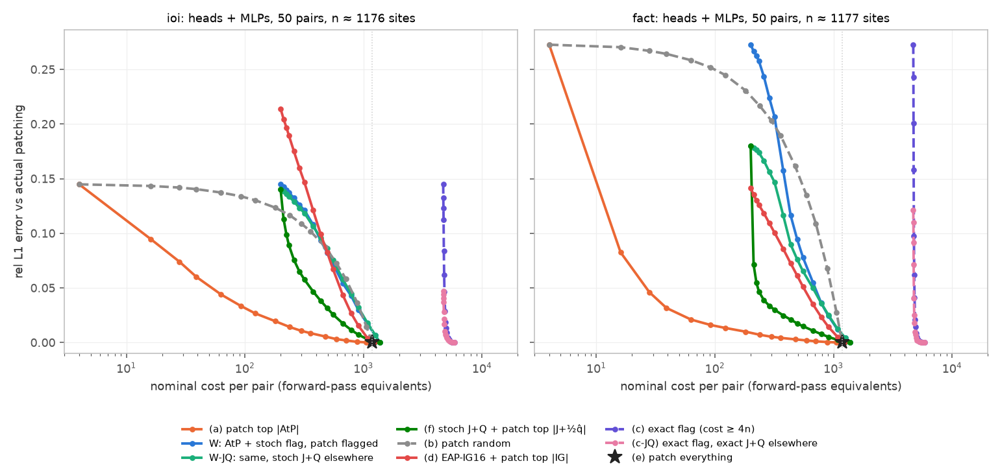
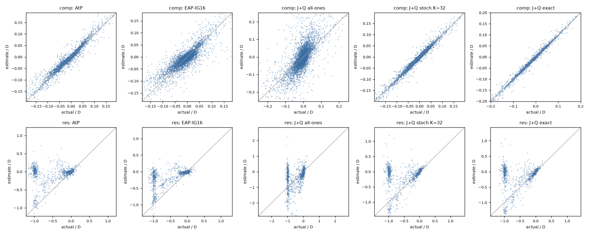
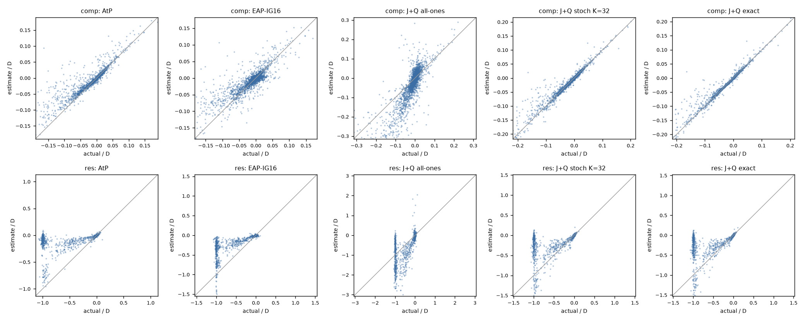
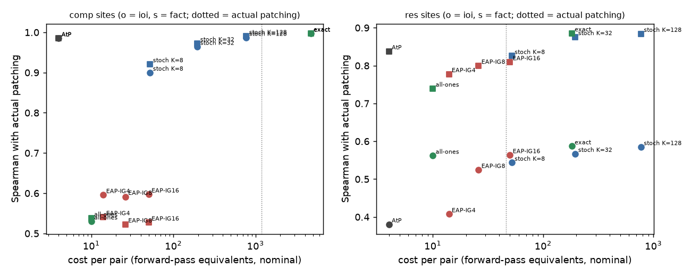

# AtP vs second order (J+Q) against activation patching

Source `outputs/atp_q_qwen3-8b`, written by `src/summarize_atp_q.py`. Model Qwen3-8B, fp32 with TF32 off, sdpa math kernel.
Noising: clean base run, each site patched with its corrupt activation; m = logit(clean answer) − logit(corrupt answer) at the last position; effects normalised per pair by D = m_clean − m_corrupt.
Sites: **heads** = per-head slice of o_proj's input at the last position (36 × 32), **mlp** = MLP output at the last position (36), **comp** = heads + mlp, **res** = block output × position (layers [0, 4, 8, 12, 16, 20, 24, 28, 32]; positions before the first differing token have δ = 0 and are dropped).

**Prior work (read before citing anything here as new).** Zhang & Wang 2026, *When Attribution Patching Lies* (arXiv 2606.09899) already correct AtP with the exact per-component Hessian term ½δᵀHδ (one HVP per component, up to 9B: GPT-2, Pythia, Qwen2.5, Gemma-2, Llama-3.1-8B; IOI, greater-than, factual recall), use the reliability score R̃ = |δᵀHδ|/(2|Δ̂|), i.e. our |½Q|/|J| (AUC 0.70 on Pythia-410M), compare multi-step HVP with per-head IG at matched cost, and find the network-level curvature 22–66× the activation's own. So exact per-site J+Q and the |½Q|/|J| flag are **replications** here (on Qwen3-8B, with exact Q at every site and FD gates). Complementary parts: (a) the stochastic all-site diagonal (Rademacher probes; cost K HVPs for every site at once, compared with EAP-IG and the deterministic all-ones HVP at equal cost), which that paper does not have (its all-at-once HVP keeps the cross terms); (c) the exact Q-lens split of each site's Q over the downstream blocks, which it does not do (its layerwise appendix is a heuristic sum that ignores mixed terms); plus partial patches λδ and residual-stream × position sites.

## Pairs and gates

Pairs dropped for |D| ≤ 0.5: {'ioi': 0, 'fact': 0}.

| task | pairs | T | m_clean median | m_corrupt median | max atp_vs_J | max one-hot HVP rel | max full-res abs | FD-of-jvp Q_rel (worst hard site) | value-FD Q_rel (worst) | FD J_rel (worst) | stoch frac abs z<3 (comp/res) | s/pair |
|---|---|---|---|---|---|---|---|---|---|---|---|---|
| ioi | 50 | 14 | 8.79 | -8.25 | 3.5e-05 | 1.7e-03 | 5.3e-05 | 7.3e-04 | 1.6e+00 | 1.5e-03 | 1.00 / 1.00 | 43 |
| fact | 50 | 7 | 12.20 | -11.98 | 1.7e-05 | 4.0e-04 | 1.8e-05 | 1.0e-03 | 1.1e+00 | 1.5e-03 | 1.00 / 1.00 | 25 |

FD-of-jvp = Q as a central difference of the first-order jvp tangent (Richardson; the hard gate, since fp32 second differences of values drown the small per-head deltas). Value FD = central differences of the final hidden state (Richardson over h, h/2; best of h = 0.2, 0.05) against the nested jvp (hard gate sites: the comp sites at the 25th and 50th percentile of AtP relative error among the top 60 by |A|, and the deepest-layer residual site at the last position). The stochastic z-score is (mean of 128 draws − exact Q)/SE; ≈0.99 expected for an unbiased estimator with a light-tailed spread.

## ioi: accuracy against actual patching

Pooled over pairs and sites (normalised effects). rel L1 = Σ|est − A| / Σ|A|. top-k = mean over pairs of |top-k by |est| ∩ top-k by |A|| / k. 'beats AtP' = share of relevant sites (max(|A|, |AtP|) ≥ 0.01 D) where |est − A| < |AtP − A|.

**heads**

| method | n | Pearson | Spearman | per-pair Spearman (median) | rel L1 | top-10 | top-50 | beats AtP | cost F (nominal) | cost s (measured) |
|---|---|---|---|---|---|---|---|---|---|---|
| AtP | 57012 | 0.971 | 0.991 | 0.992 | 0.120 | 0.85 | 0.94 | – | 4 | – |
| EAP-IG4 | 57012 | 0.909 | 0.599 | 0.595 | 0.523 | 0.79 | 0.80 | 0.14 | 14 | – |
| EAP-IG8 | 57012 | 0.908 | 0.595 | 0.611 | 0.527 | 0.79 | 0.80 | 0.14 | 26 | – |
| EAP-IG16 | 57012 | 0.910 | 0.601 | 0.621 | 0.522 | 0.80 | 0.80 | 0.14 | 50 | – |
| J+Q stoch K=8 | 57012 | 0.976 | 0.902 | 0.918 | 0.250 | 0.88 | 0.90 | 0.30 | 52 | – |
| J+Q stoch K=32 | 57012 | 0.991 | 0.966 | 0.974 | 0.133 | 0.90 | 0.94 | 0.46 | 196 | – |
| J+Q stoch K=128 | 57012 | 0.993 | 0.989 | 0.991 | 0.081 | 0.94 | 0.96 | 0.63 | 772 | – |
| J+Q all-ones | 57012 | 0.723 | 0.529 | 0.610 | 1.222 | 0.69 | 0.73 | 0.07 | 10 | – |
| J+Q exact | 57012 | 0.995 | 0.999 | 1.000 | 0.034 | 0.95 | 0.99 | 0.92 | 4562 | – |

**mlp**

| method | n | Pearson | Spearman | per-pair Spearman (median) | rel L1 | top-10 | top-50 | beats AtP | cost F (nominal) | cost s (measured) |
|---|---|---|---|---|---|---|---|---|---|---|
| AtP | 1800 | 0.966 | 0.937 | 0.962 | 0.235 | 0.86 | – | – | 4 | – |
| EAP-IG4 | 1800 | 0.848 | 0.645 | 0.616 | 0.592 | 0.67 | – | 0.18 | 14 | – |
| EAP-IG8 | 1800 | 0.847 | 0.636 | 0.635 | 0.593 | 0.67 | – | 0.18 | 26 | – |
| EAP-IG16 | 1800 | 0.850 | 0.637 | 0.652 | 0.588 | 0.68 | – | 0.19 | 50 | – |
| J+Q stoch K=8 | 1800 | 0.957 | 0.936 | 0.943 | 0.282 | 0.86 | – | 0.45 | 52 | – |
| J+Q stoch K=32 | 1800 | 0.983 | 0.971 | 0.982 | 0.168 | 0.90 | – | 0.63 | 196 | – |
| J+Q stoch K=128 | 1800 | 0.990 | 0.980 | 0.990 | 0.120 | 0.91 | – | 0.74 | 772 | – |
| J+Q all-ones | 1800 | 0.641 | 0.647 | 0.709 | 1.372 | 0.66 | – | 0.10 | 10 | – |
| J+Q exact | 1800 | 0.991 | 0.984 | 0.992 | 0.096 | 0.93 | – | 0.83 | 146 | – |

**comp**

| method | n | Pearson | Spearman | per-pair Spearman (median) | rel L1 | top-10 | top-50 | beats AtP | cost F (nominal) | cost s (measured) |
|---|---|---|---|---|---|---|---|---|---|---|
| AtP | 58812 | 0.969 | 0.985 | 0.987 | 0.145 | 0.85 | 0.93 | – | 4 | 0.06 |
| EAP-IG4 | 58812 | 0.890 | 0.596 | 0.599 | 0.538 | 0.74 | 0.78 | 0.15 | 14 | 0.04 |
| EAP-IG8 | 58812 | 0.889 | 0.591 | 0.605 | 0.541 | 0.74 | 0.79 | 0.15 | 26 | 0.08 |
| EAP-IG16 | 58812 | 0.891 | 0.597 | 0.615 | 0.536 | 0.74 | 0.78 | 0.15 | 50 | 0.15 |
| J+Q stoch K=8 | 58812 | 0.970 | 0.900 | 0.917 | 0.257 | 0.84 | 0.90 | 0.33 | 52 | 0.26 |
| J+Q stoch K=32 | 58812 | 0.988 | 0.964 | 0.971 | 0.140 | 0.91 | 0.94 | 0.50 | 196 | 0.90 |
| J+Q stoch K=128 | 58812 | 0.992 | 0.987 | 0.990 | 0.089 | 0.91 | 0.96 | 0.65 | 772 | 3.42 |
| J+Q all-ones | 58812 | 0.689 | 0.530 | 0.613 | 1.255 | 0.62 | 0.74 | 0.08 | 10 | 0.34 |
| J+Q exact | 58812 | 0.994 | 0.997 | 0.998 | 0.047 | 0.93 | 0.97 | 0.90 | 4706 | 26.37 |
| *actual patching* | | 1 | 1 | 1 | 0 | 1 | 1 | | 1177 | 4.34 |

**res**

| method | n | Pearson | Spearman | per-pair Spearman (median) | rel L1 | top-10 | top-50 | beats AtP | cost F (nominal) | cost s (measured) |
|---|---|---|---|---|---|---|---|---|---|---|
| AtP | 2367 | 0.296 | 0.380 | 0.419 | 0.858 | 0.74 | – | – | 4 | 0.06 |
| EAP-IG4 | 2367 | 0.395 | 0.407 | 0.441 | 0.803 | 0.79 | – | 0.49 | 14 | 0.04 |
| EAP-IG8 | 2367 | 0.539 | 0.524 | 0.583 | 0.735 | 0.83 | – | 0.52 | 26 | 0.08 |
| EAP-IG16 | 2367 | 0.608 | 0.564 | 0.608 | 0.698 | 0.87 | – | 0.53 | 50 | 0.15 |
| J+Q stoch K=8 | 2367 | 0.380 | 0.544 | 0.532 | 0.796 | 0.72 | – | 0.53 | 52 | 0.26 |
| J+Q stoch K=32 | 2367 | 0.394 | 0.567 | 0.573 | 0.777 | 0.73 | – | 0.60 | 196 | 0.87 |
| J+Q stoch K=128 | 2367 | 0.399 | 0.585 | 0.607 | 0.771 | 0.72 | – | 0.65 | 772 | 3.33 |
| J+Q all-ones | 2367 | 0.525 | 0.562 | 0.684 | 0.996 | 0.75 | – | 0.31 | 10 | 0.31 |
| J+Q exact | 2367 | 0.404 | 0.587 | 0.643 | 0.766 | 0.73 | – | 0.67 | 182 | 1.01 |
| *actual patching* | | 1 | 1 | 1 | 0 | 1 | 1 | | 46 | 0.17 |

### ioi: AtP false negatives

Large effect: |A| ≥ 0.05 D. AtP false negative: large and |AtP − A| > 0.5|A| (missed or wrong sign). Recovered by a method: |est − A| ≤ 0.5|A|.

| group | large sites | AtP FN | recovered by EAP-IG4 | recovered by EAP-IG8 | recovered by EAP-IG16 | recovered by J+Q stoch K=8 | recovered by J+Q stoch K=32 | recovered by J+Q stoch K=128 | recovered by J+Q all-ones | recovered by J+Q exact |
|---|---|---|---|---|---|---|---|---|---|---|
| heads | 699 | 26 | 17 | 17 | 17 | 18 | 24 | 25 | 9 | 25 |
| mlp | 321 | 22 | 9 | 10 | 10 | 15 | 18 | 18 | 6 | 18 |
| comp | 1020 | 48 | 26 | 27 | 27 | 33 | 42 | 43 | 15 | 43 |
| res | 746 | 558 | 57 | 81 | 90 | 158 | 162 | 164 | 154 | 164 |

### ioi: does |½Q|/|J| flag the sites where AtP is wrong?

Sites with max(|A|, |AtP|) ≥ 0.01 D; label = |AtP − A| > 0.5·max(|A|, |AtP|). AUC of each score as a detector (0.5 = chance).

| group | sites | AtP wrong | AUC |½Q|/|J| exact | AUC stoch K=32 | AUC stoch K=128 | AUC |½Q|/D exact | AUC ‖δ‖ |
|---|---|---|---|---|---|---|---|
| heads | 3911 | 106 | 0.983 | 0.936 | 0.977 | 0.909 | 0.646 |
| mlp | 1085 | 164 | 0.942 | 0.913 | 0.934 | 0.837 | 0.343 |
| comp | 4996 | 270 | 0.973 | 0.937 | 0.966 | 0.899 | 0.635 |
| res | 1432 | 791 | 0.827 | 0.809 | 0.821 | 0.747 | 0.629 |

### ioi: partial patches λδ (where the Taylor series stops working)

Subset per pair: the top-20 and 20 random live sites of each family by |A|. rel L1 of λJ and λJ + λ²Q/2 against the actual λ-patch; 'J+Q wins' = share of sites (|A_λ| ≥ 0.01 D) where J+Q is closer; 'A_λ/(λA_1)' median = 1 for a linear site.

| family | λ | rel L1 J | rel L1 J+Q | J+Q wins | median A_λ/(λ A_1) |
|---|---|---|---|---|---|
| comp | 0.25 | 0.043 | 0.004 | 0.96 | 0.98 |
| comp | 0.5 | 0.086 | 0.016 | 0.92 | 0.99 |
| comp | 1.0 | 0.169 | 0.061 | 0.87 | 1.00 |
| res | 0.25 | 0.267 | 0.094 | 0.87 | 0.59 |
| res | 0.5 | 0.818 | 0.717 | 0.79 | 0.94 |
| res | 1.0 | 0.858 | 0.767 | 0.65 | 1.00 |

## fact: accuracy against actual patching

Pooled over pairs and sites (normalised effects). rel L1 = Σ|est − A| / Σ|A|. top-k = mean over pairs of |top-k by |est| ∩ top-k by |A|| / k. 'beats AtP' = share of relevant sites (max(|A|, |AtP|) ≥ 0.01 D) where |est − A| < |AtP − A|.

**heads**

| method | n | Pearson | Spearman | per-pair Spearman (median) | rel L1 | top-10 | top-50 | beats AtP | cost F (nominal) | cost s (measured) |
|---|---|---|---|---|---|---|---|---|---|---|
| AtP | 57100 | 0.899 | 0.994 | 0.995 | 0.217 | 0.95 | 0.96 | – | 4 | – |
| EAP-IG4 | 57100 | 0.897 | 0.541 | 0.544 | 0.527 | 0.90 | 0.72 | 0.29 | 14 | – |
| EAP-IG8 | 57100 | 0.901 | 0.522 | 0.531 | 0.532 | 0.90 | 0.71 | 0.29 | 26 | – |
| EAP-IG16 | 57100 | 0.905 | 0.527 | 0.529 | 0.527 | 0.90 | 0.71 | 0.30 | 50 | – |
| J+Q stoch K=8 | 57100 | 0.931 | 0.924 | 0.928 | 0.262 | 0.93 | 0.88 | 0.44 | 52 | – |
| J+Q stoch K=32 | 57100 | 0.939 | 0.975 | 0.979 | 0.181 | 0.95 | 0.94 | 0.62 | 196 | – |
| J+Q stoch K=128 | 57100 | 0.942 | 0.992 | 0.994 | 0.141 | 0.97 | 0.97 | 0.78 | 772 | – |
| J+Q all-ones | 57100 | 0.899 | 0.534 | 0.585 | 1.279 | 0.84 | 0.70 | 0.09 | 10 | – |
| J+Q exact | 57100 | 0.942 | 0.999 | 1.000 | 0.108 | 0.99 | 0.99 | 0.96 | 4566 | – |

**mlp**

| method | n | Pearson | Spearman | per-pair Spearman (median) | rel L1 | top-10 | top-50 | beats AtP | cost F (nominal) | cost s (measured) |
|---|---|---|---|---|---|---|---|---|---|---|
| AtP | 1800 | 0.912 | 0.913 | 0.934 | 0.363 | 0.89 | – | – | 4 | – |
| EAP-IG4 | 1800 | 0.863 | 0.683 | 0.694 | 0.569 | 0.83 | – | 0.22 | 14 | – |
| EAP-IG8 | 1800 | 0.863 | 0.673 | 0.693 | 0.568 | 0.81 | – | 0.23 | 26 | – |
| EAP-IG16 | 1800 | 0.865 | 0.675 | 0.689 | 0.567 | 0.81 | – | 0.22 | 50 | – |
| J+Q stoch K=8 | 1800 | 0.954 | 0.951 | 0.965 | 0.240 | 0.90 | – | 0.63 | 52 | – |
| J+Q stoch K=32 | 1800 | 0.966 | 0.977 | 0.983 | 0.179 | 0.94 | – | 0.77 | 196 | – |
| J+Q stoch K=128 | 1800 | 0.969 | 0.987 | 0.992 | 0.155 | 0.96 | – | 0.84 | 772 | – |
| J+Q all-ones | 1800 | 0.897 | 0.733 | 0.784 | 1.262 | 0.80 | – | 0.12 | 10 | – |
| J+Q exact | 1800 | 0.971 | 0.990 | 0.994 | 0.142 | 0.96 | – | 0.88 | 146 | – |

**comp**

| method | n | Pearson | Spearman | per-pair Spearman (median) | rel L1 | top-10 | top-50 | beats AtP | cost F (nominal) | cost s (measured) |
|---|---|---|---|---|---|---|---|---|---|---|
| AtP | 58900 | 0.902 | 0.985 | 0.987 | 0.273 | 0.86 | 0.94 | – | 4 | 0.05 |
| EAP-IG4 | 58900 | 0.883 | 0.541 | 0.548 | 0.543 | 0.78 | 0.78 | 0.26 | 14 | 0.02 |
| EAP-IG8 | 58900 | 0.886 | 0.523 | 0.533 | 0.546 | 0.79 | 0.78 | 0.26 | 26 | 0.04 |
| EAP-IG16 | 58900 | 0.888 | 0.527 | 0.526 | 0.542 | 0.79 | 0.78 | 0.26 | 50 | 0.09 |
| J+Q stoch K=8 | 58900 | 0.939 | 0.921 | 0.928 | 0.254 | 0.90 | 0.91 | 0.53 | 52 | 0.18 |
| J+Q stoch K=32 | 58900 | 0.949 | 0.973 | 0.976 | 0.180 | 0.92 | 0.95 | 0.69 | 196 | 0.55 |
| J+Q stoch K=128 | 58900 | 0.952 | 0.991 | 0.992 | 0.146 | 0.94 | 0.97 | 0.81 | 772 | 2.03 |
| J+Q all-ones | 58900 | 0.891 | 0.538 | 0.590 | 1.273 | 0.84 | 0.78 | 0.10 | 10 | 0.31 |
| J+Q exact | 58900 | 0.952 | 0.998 | 0.999 | 0.121 | 0.94 | 0.98 | 0.92 | 4710 | 14.05 |
| *actual patching* | | 1 | 1 | 1 | 0 | 1 | 1 | | 1178 | 2.49 |

**res**

| method | n | Pearson | Spearman | per-pair Spearman (median) | rel L1 | top-10 | top-50 | beats AtP | cost F (nominal) | cost s (measured) |
|---|---|---|---|---|---|---|---|---|---|---|
| AtP | 1944 | 0.567 | 0.838 | 0.824 | 0.778 | 0.82 | – | – | 4 | 0.05 |
| EAP-IG4 | 1944 | 0.588 | 0.778 | 0.776 | 0.730 | 0.93 | – | 0.55 | 14 | 0.02 |
| EAP-IG8 | 1944 | 0.680 | 0.800 | 0.801 | 0.641 | 0.96 | – | 0.60 | 26 | 0.04 |
| EAP-IG16 | 1944 | 0.762 | 0.809 | 0.797 | 0.599 | 0.97 | – | 0.61 | 50 | 0.09 |
| J+Q stoch K=8 | 1944 | 0.627 | 0.826 | 0.816 | 0.626 | 0.82 | – | 0.66 | 52 | 0.17 |
| J+Q stoch K=32 | 1944 | 0.644 | 0.876 | 0.881 | 0.612 | 0.84 | – | 0.73 | 196 | 0.53 |
| J+Q stoch K=128 | 1944 | 0.646 | 0.884 | 0.896 | 0.610 | 0.85 | – | 0.77 | 772 | 1.97 |
| J+Q all-ones | 1944 | 0.746 | 0.739 | 0.732 | 0.908 | 0.86 | – | 0.36 | 10 | 0.29 |
| J+Q exact | 1944 | 0.649 | 0.886 | 0.888 | 0.609 | 0.84 | – | 0.80 | 182 | 0.61 |
| *actual patching* | | 1 | 1 | 1 | 0 | 1 | 1 | | 46 | 0.10 |

### fact: AtP false negatives

Large effect: |A| ≥ 0.05 D. AtP false negative: large and |AtP − A| > 0.5|A| (missed or wrong sign). Recovered by a method: |est − A| ≤ 0.5|A|.

| group | large sites | AtP FN | recovered by EAP-IG4 | recovered by EAP-IG8 | recovered by EAP-IG16 | recovered by J+Q stoch K=8 | recovered by J+Q stoch K=32 | recovered by J+Q stoch K=128 | recovered by J+Q all-ones | recovered by J+Q exact |
|---|---|---|---|---|---|---|---|---|---|---|
| heads | 251 | 54 | 10 | 13 | 12 | 30 | 26 | 30 | 38 | 29 |
| mlp | 303 | 73 | 20 | 27 | 24 | 51 | 54 | 59 | 15 | 58 |
| comp | 554 | 127 | 30 | 40 | 36 | 81 | 80 | 89 | 53 | 87 |
| res | 616 | 506 | 39 | 75 | 99 | 178 | 198 | 186 | 154 | 181 |

### fact: does |½Q|/|J| flag the sites where AtP is wrong?

Sites with max(|A|, |AtP|) ≥ 0.01 D; label = |AtP − A| > 0.5·max(|A|, |AtP|). AUC of each score as a detector (0.5 = chance).

| group | sites | AtP wrong | AUC |½Q|/|J| exact | AUC stoch K=32 | AUC stoch K=128 | AUC |½Q|/D exact | AUC ‖δ‖ |
|---|---|---|---|---|---|---|---|
| heads | 937 | 71 | 0.962 | 0.933 | 0.956 | 0.933 | 0.556 |
| mlp | 829 | 170 | 0.950 | 0.921 | 0.943 | 0.839 | 0.750 |
| comp | 1766 | 241 | 0.960 | 0.933 | 0.954 | 0.888 | 0.714 |
| res | 1008 | 632 | 0.882 | 0.858 | 0.873 | 0.757 | 0.562 |

### fact: partial patches λδ (where the Taylor series stops working)

Subset per pair: the top-20 and 20 random live sites of each family by |A|. rel L1 of λJ and λJ + λ²Q/2 against the actual λ-patch; 'J+Q wins' = share of sites (|A_λ| ≥ 0.01 D) where J+Q is closer; 'A_λ/(λA_1)' median = 1 for a linear site.

| family | λ | rel L1 J | rel L1 J+Q | J+Q wins | median A_λ/(λ A_1) |
|---|---|---|---|---|---|
| comp | 0.25 | 0.087 | 0.014 | 0.99 | 0.89 |
| comp | 0.5 | 0.185 | 0.058 | 0.97 | 0.93 |
| comp | 1.0 | 0.345 | 0.165 | 0.93 | 1.00 |
| res | 0.25 | 0.317 | 0.135 | 0.98 | 0.47 |
| res | 0.5 | 0.755 | 0.630 | 0.92 | 0.91 |
| res | 1.0 | 0.778 | 0.609 | 0.80 | 1.00 |

## ioi: where the second-order part of the AtP error lives (exact Q-lens split)

Top-10 comp and top-5 res sites by |A| per pair. Q_s = Σ_k ⟨g_k, D²f_k[u_k, u_k]⟩ + final-norm term + own, exact by the chain rule (own = the MLP half of the head's layer; 0 for mlp/res sites, checked). 'first' = the first nonlinearity the patch meets (heads: own MLP half; mlp/res: the next block). Medians over sites.

| group | sites | |½Q|/|A−J| | |A−J−½Q|/|A−J| | first share | others / first | top block share | blocks for 90% | final-norm share | |Σ|/Σ|·| |
|---|---|---|---|---|---|---|---|---|---|
| heads | 325 | 0.96 | 0.23 | 0.03 | 28.9 | 0.48 | 4 | 0.06 | 0.79 |
| mlp | 175 | 0.95 | 0.21 | 0.17 | 4.9 | 0.37 | 5 | 0.09 | 0.76 |
| res | 250 | 0.08 | 0.99 | 0.11 | 8.4 | 0.17 | 15 | 0.01 | 0.24 |

## fact: where the second-order part of the AtP error lives (exact Q-lens split)

Top-10 comp and top-5 res sites by |A| per pair. Q_s = Σ_k ⟨g_k, D²f_k[u_k, u_k]⟩ + final-norm term + own, exact by the chain rule (own = the MLP half of the head's layer; 0 for mlp/res sites, checked). 'first' = the first nonlinearity the patch meets (heads: own MLP half; mlp/res: the next block). Medians over sites.

| group | sites | |½Q|/|A−J| | |A−J−½Q|/|A−J| | first share | others / first | top block share | blocks for 90% | final-norm share | |Σ|/Σ|·| |
|---|---|---|---|---|---|---|---|---|---|
| heads | 213 | 0.74 | 0.35 | 0.13 | 6.8 | 0.38 | 5 | 0.14 | 0.93 |
| mlp | 287 | 0.86 | 0.30 | 0.19 | 4.4 | 0.42 | 4 | 0.21 | 0.90 |
| res | 250 | 0.11 | 0.90 | 0.06 | 16.6 | 0.19 | 16 | 0.01 | 0.65 |

<!-- flag-then-patch:start -->
## Flag-then-patch

**Verdict.** No. AtP + the stochastic K=32 flag + patching the flagged x% (W) does not beat patching the top x% by |AtP| (a) on error or on top-k recall, at any x in either task. At W's own cost ((a=): AtP + the top x n + 196 sites by |AtP|), the |AtP| route has the lower rel L1 at every x (W is lower in at most 0 of 50 pairs at any x): at x = 10% (318 F, 27% of patching everything) rel L1 is 0.121 (W) vs 0.010 (a=) on IOI and 0.207 vs 0.005 on fact, top-10 recall 0.85 / 0.89 vs 1.00 / 1.00. W loses even to (a) at the same x without the extra 196 F (0.027 / 0.013) and is only a little better than patching a random x% (0.130 / 0.245). The reason: the flag ranks sites by AtP's *relative* error, which is largest where effects are small, while the absolute error sits at the large-|AtP| sites. The one metric W wins is the whole-list per-pair Spearman over all ~1170 sites, which small sites dominate: W beats (a=) from x = 5% (IOI) / 10% (fact), e.g. 0.998 vs 0.993 / 0.998 vs 0.996 at x = 10%. Keeping the stochastic J+Q elsewhere (W-JQ) does not change the verdict. With q̂ in hand, ranking by |J + ½q̂| (f) beats ranking by the flag (W-JQ lower in at most 0 of 50 pairs at any x > 0), but still loses to (a=) (0.058 / 0.030 at x = 10%). The exact flag (c), at ≥ 4n cost, is worse than |AtP| ranking at the same x up to 20% and level at 30%. EAP-IG16 at matched cost (d) is also worse than (a=) (0.147 / 0.101; ρ 0.73 / 0.69). Practical reading: at ~1170 sites the cheap accurate route is AtP, then patch the top few % by |AtP|. The top 5% (63 F, 5% of patching everything) gives rel L1 0.044 / 0.021 and top-10 recall 1.00 / 0.99, against exact J+Q at every site at 0.047 / 0.121 for 4706 F. The flag is a good diagnostic (AUC tables above) but not a patching priority.

Script `src/flag_then_patch.py` (CPU, reads `outputs/atp_q_qwen3-8b`). Sites: heads + MLPs at the last position with δ ≠ 0, n = 1176 (IOI) / 1177 (fact) per pair (median); 50 + 50 pairs. Patched sites take their actual patching value; all other sites keep the named estimate. Metrics against actual patching, effects normalised by D: rel L1 = Σ|est − A| / Σ|A| pooled over pairs; top-k = mean over pairs of |top-k by |est| ∩ top-k by |A|| / k; ρ = median per-pair Spearman. Flag = |½q̂|/|J| with q̂ the mean of the first 32 Rademacher draws (stoch) or the exact Q (exact). Random (b) is the mean over 20 draws per pair.

Nominal cost (forward-pass equivalents, median over pairs; x n sites patched at 1 F each): W, W-JQ, (a=), (f), (d) = 200 + x n (AtP 4 + stochastic K=32 196, as specified; (a=) spends the 196 on extra |AtP|-ranked patches, (d) = EAP-IG16 50 + top-|IG| patches to the same total); (a), (b) = 4 + x n; (c), (c-JQ) = 2 + 4n + x n (exact J+Q for every site, more than patching everything); (e) patch everything = 1 + n ≈ 1177. Measured seconds (median per pair, both tasks): the K=32 stochastic pass 0.73 s against 3.77 s for patching all ~1176 sites in batches of 127, i.e. ≈226 patched sites (nominal: 196).

**Nominal cost (F, IOI; fact within ±1%)**

| method | x = 0% | x = 2% | x = 5% | x = 10% | x = 20% | x = 30% | x = 50% |
|---|---|---|---|---|---|---|---|
| **W**: stoch flag, AtP elsewhere | 200 | 224 | 259 | 318 | 435 | 553 | 788 |
| **W-JQ**: stoch flag, stoch J+Q elsewhere | 200 | 224 | 259 | 318 | 435 | 553 | 788 |
| (a) top \|AtP\|, same x | 4 | 28 | 63 | 122 | 239 | 357 | 592 |
| (a=) top \|AtP\|, W's cost (x n + 196 sites) | 200 | 224 | 259 | 318 | 435 | 553 | 788 |
| (f) top \|J+½q̂\|, stoch J+Q elsewhere (W-JQ's cost) | 200 | 224 | 259 | 318 | 435 | 553 | 788 |
| (b) random x, AtP elsewhere | 4 | 28 | 63 | 122 | 239 | 357 | 592 |
| (c) exact flag, AtP elsewhere | 4706 | 4730 | 4765 | 4824 | 4941 | 5059 | 5294 |
| (c-JQ) exact flag, exact J+Q elsewhere | 4706 | 4730 | 4765 | 4824 | 4941 | 5059 | 5294 |
| (d) EAP-IG16 + top \|IG\| at W's cost, IG elsewhere | 200 | 224 | 259 | 318 | 435 | 553 | 788 |
| (e) patch everything | 1177 (all x) | | | | | | |

**ioi: rel L1 against actual patching** (lower is better; (e) = 0)

| method | x = 0% | x = 2% | x = 5% | x = 10% | x = 20% | x = 30% | x = 50% |
|---|---|---|---|---|---|---|---|
| **W**: stoch flag, AtP elsewhere | 0.145 | 0.140 | 0.133 | 0.121 | 0.094 | 0.072 | 0.043 |
| **W-JQ**: stoch flag, stoch J+Q elsewhere | 0.140 | 0.136 | 0.129 | 0.119 | 0.096 | 0.076 | 0.045 |
| (a) top \|AtP\|, same x | 0.145 | 0.074 | 0.044 | 0.027 | 0.014 | 0.009 | 0.003 |
| (a=) top \|AtP\|, W's cost (x n + 196 sites) | 0.018 | 0.016 | 0.013 | 0.010 | 0.006 | 0.004 | 0.001 |
| (f) top \|J+½q̂\|, stoch J+Q elsewhere (W-JQ's cost) | 0.140 | 0.099 | 0.076 | 0.058 | 0.038 | 0.026 | 0.012 |
| (b) random x, AtP elsewhere | 0.145 | 0.142 | 0.137 | 0.130 | 0.117 | 0.102 | 0.073 |
| (c) exact flag, AtP elsewhere | 0.145 | 0.123 | 0.084 | 0.046 | 0.019 | 0.009 | 0.002 |
| (c-JQ) exact flag, exact J+Q elsewhere | 0.047 | 0.041 | 0.028 | 0.017 | 0.007 | 0.004 | 0.002 |
| (d) EAP-IG16 + top \|IG\| at W's cost, IG elsewhere | 0.214 | 0.197 | 0.175 | 0.147 | 0.099 | 0.067 | 0.027 |

**ioi: top-10 / top-50 recall / per-pair Spearman ρ** ((e) = 1 / 1 / 1)

| method | x = 0% | x = 2% | x = 5% | x = 10% | x = 20% | x = 30% | x = 50% |
|---|---|---|---|---|---|---|---|
| **W**: stoch flag, AtP elsewhere | 0.85 / 0.93 / 0.987 | 0.84 / 0.93 / 0.990 | 0.84 / 0.93 / 0.994 | 0.85 / 0.94 / 0.998 | 0.87 / 0.96 / 0.999 | 0.90 / 0.97 / 1.000 | 0.93 / 0.98 / 1.000 |
| **W-JQ**: stoch flag, stoch J+Q elsewhere | 0.91 / 0.94 / 0.971 | 0.91 / 0.94 / 0.974 | 0.91 / 0.95 / 0.982 | 0.91 / 0.95 / 0.995 | 0.92 / 0.96 / 0.998 | 0.93 / 0.97 / 0.999 | 0.95 / 0.98 / 1.000 |
| (a) top \|AtP\|, same x | 0.85 / 0.93 / 0.987 | 0.99 / 0.93 / 0.987 | 1.00 / 0.96 / 0.987 | 1.00 / 0.99 / 0.991 | 1.00 / 0.99 / 0.993 | 1.00 / 1.00 / 0.993 | 1.00 / 1.00 / 0.997 |
| (a=) top \|AtP\|, W's cost (x n + 196 sites) | 1.00 / 0.99 / 0.992 | 1.00 / 0.99 / 0.992 | 1.00 / 0.99 / 0.993 | 1.00 / 1.00 / 0.993 | 1.00 / 1.00 / 0.995 | 1.00 / 1.00 / 0.996 | 1.00 / 1.00 / 0.999 |
| (f) top \|J+½q̂\|, stoch J+Q elsewhere (W-JQ's cost) | 0.91 / 0.94 / 0.971 | 1.00 / 0.94 / 0.971 | 1.00 / 0.98 / 0.971 | 1.00 / 1.00 / 0.972 | 1.00 / 1.00 / 0.975 | 1.00 / 1.00 / 0.978 | 1.00 / 1.00 / 0.984 |
| (b) random x, AtP elsewhere | 0.85 / 0.93 / 0.987 | 0.85 / 0.93 / 0.987 | 0.85 / 0.93 / 0.988 | 0.85 / 0.93 / 0.988 | 0.86 / 0.94 / 0.990 | 0.87 / 0.94 / 0.991 | 0.90 / 0.95 / 0.994 |
| (c) exact flag, AtP elsewhere | 0.85 / 0.93 / 0.987 | 0.85 / 0.94 / 0.999 | 0.88 / 0.96 / 1.000 | 0.94 / 0.97 / 1.000 | 0.98 / 0.99 / 1.000 | 0.99 / 0.99 / 1.000 | 1.00 / 1.00 / 1.000 |
| (c-JQ) exact flag, exact J+Q elsewhere | 0.93 / 0.97 / 0.998 | 0.94 / 0.98 / 1.000 | 0.95 / 0.99 / 1.000 | 0.97 / 0.99 / 1.000 | 0.99 / 0.99 / 1.000 | 0.99 / 1.00 / 1.000 | 1.00 / 1.00 / 1.000 |
| (d) EAP-IG16 + top \|IG\| at W's cost, IG elsewhere | 0.99 / 0.97 / 0.664 | 0.99 / 0.97 / 0.678 | 0.99 / 0.98 / 0.702 | 0.99 / 0.98 / 0.731 | 1.00 / 0.99 / 0.790 | 1.00 / 0.99 / 0.843 | 1.00 / 1.00 / 0.930 |

**ioi: head to head, share of pairs where the first method is better**

| x | W vs (a=), rel L1 | W vs (a=), ρ | W vs (a) same x, rel L1 | W-JQ vs (f), rel L1 | W vs (b), rel L1 |
|---|---|---|---|---|---|
| 2% | 0.00 | 0.30 | 0.00 | 0.00 | 0.50 |
| 5% | 0.00 | 0.64 | 0.00 | 0.00 | 0.62 |
| 10% | 0.00 | 0.86 | 0.00 | 0.00 | 0.78 |
| 20% | 0.00 | 0.88 | 0.00 | 0.00 | 0.86 |
| 30% | 0.00 | 0.88 | 0.00 | 0.00 | 0.94 |
| 50% | 0.00 | 0.92 | 0.00 | 0.00 | 1.00 |

**fact: rel L1 against actual patching** (lower is better; (e) = 0)

| method | x = 0% | x = 2% | x = 5% | x = 10% | x = 20% | x = 30% | x = 50% |
|---|---|---|---|---|---|---|---|
| **W**: stoch flag, AtP elsewhere | 0.273 | 0.262 | 0.243 | 0.207 | 0.116 | 0.078 | 0.036 |
| **W-JQ**: stoch flag, stoch J+Q elsewhere | 0.180 | 0.176 | 0.166 | 0.147 | 0.090 | 0.065 | 0.036 |
| (a) top \|AtP\|, same x | 0.273 | 0.046 | 0.021 | 0.013 | 0.007 | 0.004 | 0.002 |
| (a=) top \|AtP\|, W's cost (x n + 196 sites) | 0.009 | 0.008 | 0.006 | 0.005 | 0.003 | 0.002 | 0.001 |
| (f) top \|J+½q̂\|, stoch J+Q elsewhere (W-JQ's cost) | 0.180 | 0.055 | 0.039 | 0.030 | 0.021 | 0.015 | 0.008 |
| (b) random x, AtP elsewhere | 0.273 | 0.267 | 0.258 | 0.245 | 0.217 | 0.190 | 0.135 |
| (c) exact flag, AtP elsewhere | 0.273 | 0.201 | 0.098 | 0.041 | 0.014 | 0.005 | 0.001 |
| (c-JQ) exact flag, exact J+Q elsewhere | 0.121 | 0.091 | 0.040 | 0.018 | 0.007 | 0.002 | 0.001 |
| (d) EAP-IG16 + top \|IG\| at W's cost, IG elsewhere | 0.141 | 0.130 | 0.118 | 0.101 | 0.073 | 0.051 | 0.023 |

**fact: top-10 / top-50 recall / per-pair Spearman ρ** ((e) = 1 / 1 / 1)

| method | x = 0% | x = 2% | x = 5% | x = 10% | x = 20% | x = 30% | x = 50% |
|---|---|---|---|---|---|---|---|
| **W**: stoch flag, AtP elsewhere | 0.86 / 0.94 / 0.987 | 0.86 / 0.94 / 0.989 | 0.88 / 0.95 / 0.994 | 0.89 / 0.95 / 0.998 | 0.93 / 0.97 / 1.000 | 0.94 / 0.97 / 1.000 | 0.96 / 0.98 / 1.000 |
| **W-JQ**: stoch flag, stoch J+Q elsewhere | 0.92 / 0.95 / 0.976 | 0.93 / 0.95 / 0.979 | 0.94 / 0.95 / 0.985 | 0.95 / 0.95 / 0.995 | 0.95 / 0.96 / 0.998 | 0.96 / 0.97 / 0.999 | 0.97 / 0.98 / 1.000 |
| (a) top \|AtP\|, same x | 0.86 / 0.94 / 0.987 | 0.97 / 0.94 / 0.988 | 0.99 / 0.97 / 0.991 | 1.00 / 0.99 / 0.992 | 1.00 / 1.00 / 0.995 | 1.00 / 1.00 / 0.996 | 1.00 / 1.00 / 0.998 |
| (a=) top \|AtP\|, W's cost (x n + 196 sites) | 1.00 / 0.99 / 0.993 | 1.00 / 1.00 / 0.994 | 1.00 / 1.00 / 0.995 | 1.00 / 1.00 / 0.996 | 1.00 / 1.00 / 0.997 | 1.00 / 1.00 / 0.997 | 1.00 / 1.00 / 0.999 |
| (f) top \|J+½q̂\|, stoch J+Q elsewhere (W-JQ's cost) | 0.92 / 0.95 / 0.976 | 0.99 / 0.95 / 0.976 | 1.00 / 0.98 / 0.978 | 1.00 / 1.00 / 0.978 | 1.00 / 1.00 / 0.979 | 1.00 / 1.00 / 0.982 | 1.00 / 1.00 / 0.986 |
| (b) random x, AtP elsewhere | 0.86 / 0.94 / 0.987 | 0.86 / 0.94 / 0.987 | 0.86 / 0.94 / 0.988 | 0.86 / 0.94 / 0.989 | 0.87 / 0.95 / 0.990 | 0.87 / 0.95 / 0.991 | 0.90 / 0.96 / 0.993 |
| (c) exact flag, AtP elsewhere | 0.86 / 0.94 / 0.987 | 0.89 / 0.95 / 0.999 | 0.93 / 0.97 / 1.000 | 0.96 / 0.98 / 1.000 | 0.99 / 0.99 / 1.000 | 1.00 / 0.99 / 1.000 | 1.00 / 1.00 / 1.000 |
| (c-JQ) exact flag, exact J+Q elsewhere | 0.94 / 0.98 / 0.999 | 0.96 / 0.99 / 1.000 | 0.97 / 0.99 / 1.000 | 0.99 / 0.99 / 1.000 | 1.00 / 1.00 / 1.000 | 1.00 / 1.00 / 1.000 | 1.00 / 1.00 / 1.000 |
| (d) EAP-IG16 + top \|IG\| at W's cost, IG elsewhere | 1.00 / 0.94 / 0.611 | 1.00 / 0.96 / 0.626 | 1.00 / 0.96 / 0.644 | 1.00 / 0.97 / 0.685 | 1.00 / 0.98 / 0.748 | 1.00 / 0.99 / 0.814 | 1.00 / 1.00 / 0.917 |

**fact: head to head, share of pairs where the first method is better**

| x | W vs (a=), rel L1 | W vs (a=), ρ | W vs (a) same x, rel L1 | W-JQ vs (f), rel L1 | W vs (b), rel L1 |
|---|---|---|---|---|---|
| 2% | 0.00 | 0.24 | 0.00 | 0.00 | 0.42 |
| 5% | 0.00 | 0.48 | 0.00 | 0.00 | 0.64 |
| 10% | 0.00 | 0.84 | 0.00 | 0.00 | 0.76 |
| 20% | 0.00 | 0.90 | 0.00 | 0.00 | 0.96 |
| 30% | 0.00 | 0.90 | 0.00 | 0.00 | 1.00 |
| 50% | 0.00 | 0.90 | 0.00 | 0.00 | 1.00 |

<!-- flag-then-patch:end -->

## Figures

## Cost model

Nominal forward-pass equivalents per pair for one family of n live sites: actual patching 1 + n; AtP 4 (clean forward + backward, corrupt forward; all families at once); EAP-IG m: 2 + 3m (all families); J+Q stochastic K: 4 + 6K per family (one reverse-over-forward HVP ≈ jvp 2 + backward 4); J+Q exact 2 + 4n (one nested jvp per site, an upper bound: tangents start at the site's layer). Measured seconds are per pair on the job's GPU with the batching used (patching 127 sites per forward), split proportionally between families; batched and unbatched passes are not comparable one to one.

